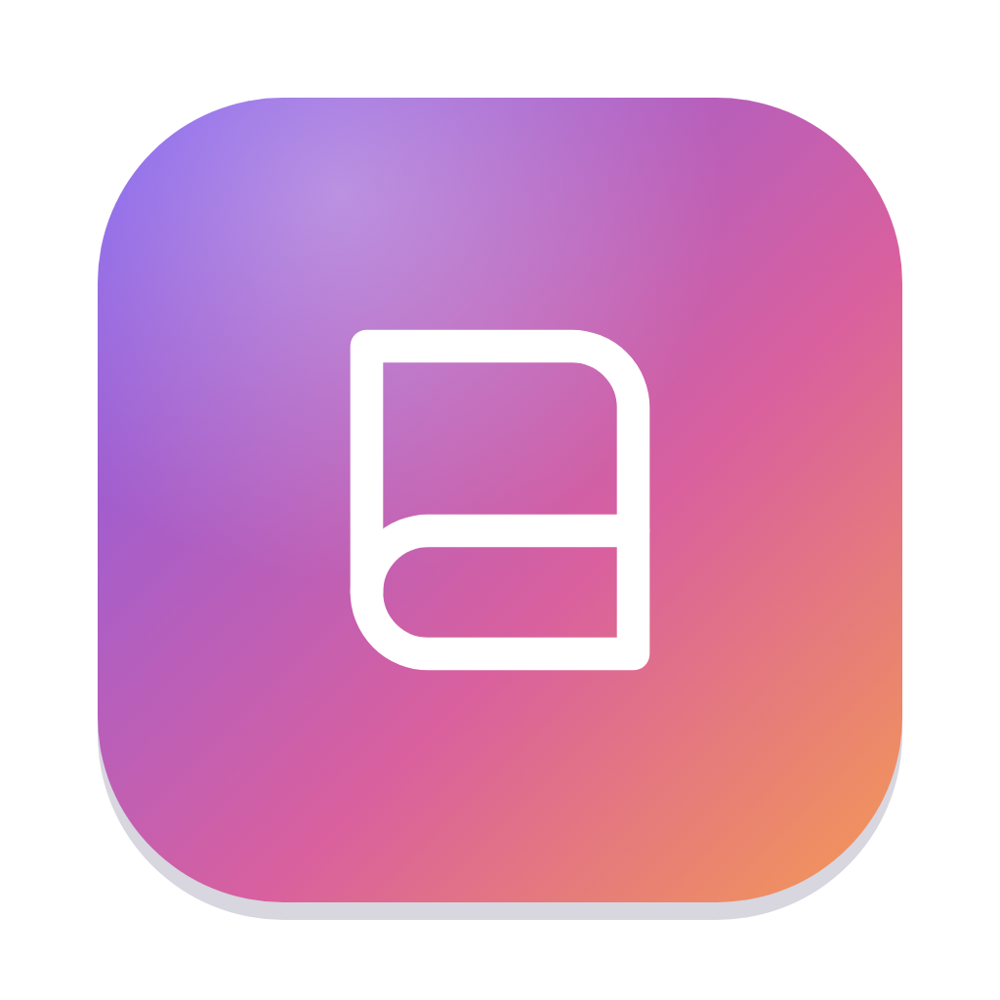

# Folio

**A private journal for your words, photos, drawings, recordings, places and moods.**

Folio is a desktop app for Windows and Mac. Your journal is saved as ordinary files in a folder you choose, so you can see it, back it up, or keep it in OneDrive, Dropbox or iCloud Drive.

A Caffeine Not Included tool.

## What's inside

| Feature | What it does |
| --- | --- |
| **Entries** | Title and text, with photos, a camera shot, drawings, recordings, a location and your state of mind as tiles above the text |
| **Suggestions** | Reflection prompts, plus "on this day", "a month ago" and bookmarked entries from your own journal |
| **State of mind** | Emotion (right now) or Mood (today), a pleasant–unpleasant scale, feelings, and what's affecting you |
| **Journals** | Several journals with their own colours; move entries between them |
| **Insights** | Streaks, entries and words this year, a calendar tinted by mood, a 30-day mood chart, feelings and places |
| **Search and filters** | Search everything; filter by bookmarks, photos, drawings, recordings, places, state of mind or reflections |
| **Passcode lock** | A 4-digit passcode when Folio opens, and again after you leave it (straight away, or after 1, 5 or 15 minutes) |
| **Export** | All entries as one text file, or a full backup with attachments that Folio can restore |

## Download

Get the latest version from the [Releases](../../releases) page:

| Your computer | File to download |
| --- | --- |
| Windows 10 or 11 | `Folio_x.x.x_x64_en-US.msi` (or the `-setup.exe`) |
| Mac, Apple Silicon or Intel, macOS 11 or later | `Folio_x.x.x_universal.dmg` |

## Install

Folio isn't code-signed yet, so your computer asks you to confirm it the first time.

**Windows**

1. Run the `.msi` or `-setup.exe`.
2. If a blue *Windows protected your PC* box appears, click **More info**, then **Run anyway**.

**Mac**

1. Open the `.dmg` and drag **Folio** into **Applications**.
2. Open Folio. When macOS says it can't check the app, click **Done**.
3. Open **System Settings → Privacy & Security**, scroll down to the message about Folio, click **Open Anyway** and confirm.

If macOS says the app *is damaged and can't be opened*, run this once in Terminal, then open it again:

```
xattr -cr "/Applications/Folio.app"
```

If you keep your journal in Documents, macOS asks once whether Folio may use that folder. Click **Allow**.

## Your journal

The first time Folio opens, it asks where to keep your journal. You can change this any time in **Settings → Journal Folder**, which also has **Show in File Explorer** (or **Show in Finder**) and **Copy Path**.

- **Suggested folder.** `Documents\Folio` on Windows, `~/Documents/Folio` on a Mac.
- **Choosing a folder.** If the folder you pick already holds other files, Folio makes a `Folio` folder inside it, so your entries never mix with anything else.
- **Moving your journal.** Folio copies your entries into the new folder and starts saving there. The old folder is left as it was, so you can delete it yourself once you've checked the new one.
- **A folder that already has a journal**, for example one from another computer: choose **Open That Journal** to use it as it is, or **Add My Entries to It** to copy this computer's entries in. Nothing in either folder is overwritten.
- **Several computers.** Choose a folder inside OneDrive, Dropbox or iCloud Drive on each computer, and keep Folio open on one computer at a time. When you switch back to Folio, it loads changes made elsewhere.

What's in the folder:

| Path | What it is |
| --- | --- |
| `folio.json` | Your journals and settings |
| `Entries/2026/2026-10-18 Title (a1b2c3).md` | One Markdown file per entry: details at the top, your writing below. Any text editor can open it |
| `Attachments/` | Photos and drawings (`.jpg`) and recordings (`.mp3`, `.m4a`, `.wav` and so on) |
| `Attachments/Thumbnails/` | Small copies of photos for the timeline |
| `Recently Deleted/` | Deleted entries and attachments, kept for 30 days and then removed |

**About the passcode.** The passcode stops someone opening your journal in Folio. The files themselves aren't encrypted, so anyone who can open the folder on your computer can read them. Keep the folder somewhere private if that matters to you.

### Moving entries from the Claude version

1. In Folio on Claude, go to **Settings → Back Up Everything** and save the file.
2. In the desktop app, go to **Settings → Restore from Backup** and choose that file.

## Build it yourself

You need [Node.js](https://nodejs.org) 20 or newer, [Rust](https://rustup.rs), and the [Tauri prerequisites](https://v2.tauri.app/start/prerequisites/) for your system (Microsoft C++ Build Tools on Windows, Xcode Command Line Tools on Mac).

```
npm install
npm run dev      # run the app from this folder
npm run build    # make an installer in src-tauri/target/release/bundle
```

Run the storage tests with `cargo test` inside `src-tauri`.

### Release a new version

The **Build installers** workflow builds the Windows and Mac installers on GitHub and puts them in a draft release.

1. Replace `web/folio.html` with the new page, if the app changed.
2. Raise the version in `package.json`, `src-tauri/tauri.conf.json` and `src-tauri/Cargo.toml`, for example to `1.1.0`.
3. Commit, then either open **Actions → Build installers → Run workflow**, or push a tag: `git tag v1.1.0 && git push --tags`.
4. When both builds are green, open **Releases**, check the draft and click **Publish release**.

### Project layout

| Path | What it is |
| --- | --- |
| `web/folio.html` | The app page, shared with the Claude version. Inside the desktop app it saves to the journal folder; on Claude it saves to your account |
| `scripts/make-dist.mjs` | Builds `dist/` from the page with the Inter font bundled, so the app works offline |
| `src-tauri/src/store.rs` | The journal folder: reading and writing entries and attachments, Recently Deleted, moving and merging folders (with tests) |
| `src-tauri/src/lib.rs` | The commands the page calls, the folder chooser, Save dialogs and where the chosen folder is remembered |
| `src-tauri/tauri.conf.json` | App name, version, window size, icons and installer settings |
| `assets/app-icon.svg` | The app icon. After editing, export a 1024 px PNG to `assets/app-icon.png` and run `npx tauri icon assets/app-icon.png` |
| `.github/workflows/build.yml` | The GitHub build for Windows and Mac |

## Credits

Built with [Tauri](https://tauri.app). Font: [Inter](https://rsms.me/inter/), under the SIL Open Font License.

© Caffeine Not Included
